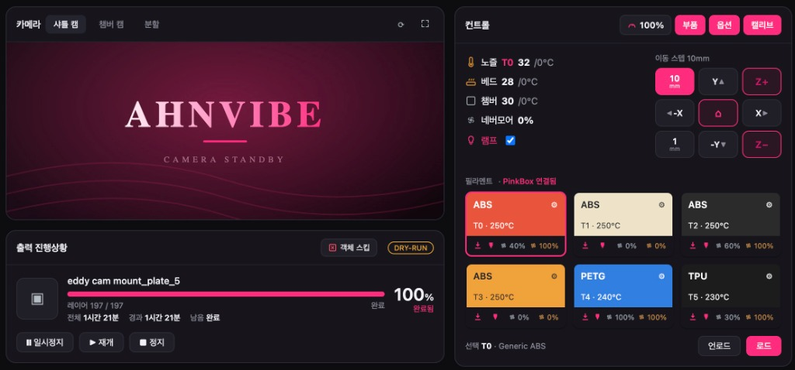
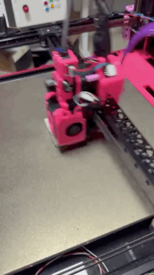
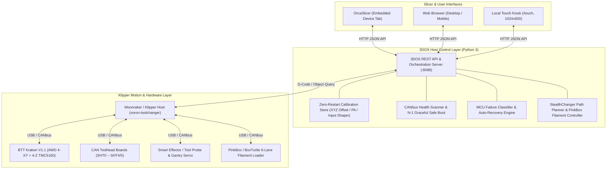
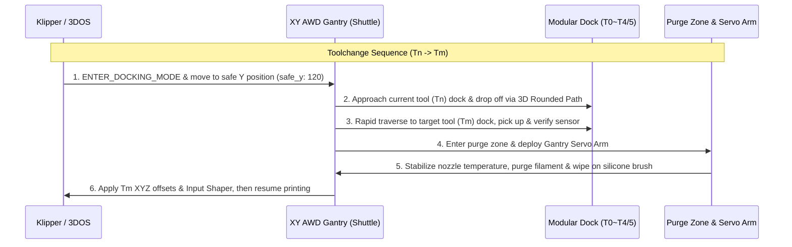

# 3DPrinter — 3DOS & Voron 2.4 AWD StealthChanger Toolchanger

> **Developer:** Yeonjo Ahn

This repository contains the complete hardware, firmware, and software control stack for a custom **Voron 2.4 350mm Crossed AWD + StealthChanger Multi-Tool 3D Printer**, paired with **3DOS**—a next-generation host orchestration and unified device UI layer engineered for multi-toolhead 3D printers.

---

## 1. Visual Showcase — Hardware Build & 3DOS Interface

### 3DOS Live Interface on Raspberry Pi

*3DOS unified control dashboard running on the Raspberry Pi host (`:8088`), displaying dual camera streams (`Shuttle Cam` / `Chamber Cam`), active shuttle toolhead temperature (`T0`), multi-tool material/color tiles (`T0`–`T5` across ABS, PETG, TPU) with dual filament sensor indicators, PinkBox spool loader integration, and real-time print progress with object skipping.*

### Voron 2.4 350mm Crossed AWD + StealthChanger Hardware

| Multi-Tool Dock Array (5/6-Tool StealthChanger) | Active Toolhead Shuttle & High-Speed Printing |
| :---: | :---: |
|  |  |
| *Voron 2.4 350mm AWD frame with modular StealthChanger toolhead docks, umbilical CAN harnesses, and Gantry Servo purge/wipe unit.* | *Lightweight CNC/carbon-reinforced shuttle carrying an active toolhead with onboard Fly-SHT36 CAN board, Galileo 2 extruder, and dual filament sensors.* |

### Video Demonstration — Active Toolhead Printing & Motion

| Auto-Playing Preview (Click for Full MP4 Video) | Interactive HTML5 Video Player |
| :---: | :---: |
| [](./assets/voron24_demo.mp4) | <video src="./assets/voron24_demo.mp4" controls autoplay loop muted playsinline width="320" poster="./assets/voron24_toolhead_printing.jpg"><a href="./assets/voron24_demo.mp4">Download / Watch MP4 Video (`./assets/voron24_demo.mp4`)</a></video> |
| *Click the animated preview above to open [`voron24_demo.mp4`](./assets/voron24_demo.mp4) with audio.* | *Direct HTML5 `<video>` stream (`./assets/voron24_demo.mp4`) for local Markdown viewers.* |

---

## 2. Project Overview & System Architecture

Unlike single-extruder 3D printers, a multi-toolhead system requires **managing multiple CAN toolboards (`SHT36`), per-tool XYZ offset calibration, dock pickup/dropoff path planning, and multi-lane filament loader (`PinkBox` / `BoxTurtle`) synchronization**. The standard Klipper + Moonraker + Mainsail stack was originally designed around a single toolhead, creating operational bottlenecks in multi-tool workflows.

This project solves those challenges through two tightly integrated pillars:
1. **3DOS (`3dos/`)**: A zero-dependency Python host orchestration server and unified Web / Slicer / Touch UI purpose-built for multi-toolhead printers.
2. **Voron 2.4 AWD StealthChanger (`voron-toolchanger/`)**: A high-rigidity Crossed AWD 4-motor XY motion system, modular StealthChanger coupling docks, CANbus toolheads, and automated filament loading/purging hardware.



---

## 3. Core Concept I: 3DOS (3D Operating System for Multi-Tool Printers)

**3DOS** preserves Klipper's real-time MCU step generation while introducing an intelligent **multi-tool operating system and UI layer** above it. Built entirely on the Python 3 standard library and a zero-dependency single-page HTML frontend, 3DOS can run alongside Mainsail or operate standalone.

### Key Innovations

#### 1. Separation of Hardware Config & Runtime State — Zero-Restart Calibration
* **The Problem:** In standard Klipper, saving tool offsets, Pressure Advance (PA), or Input Shaper via `SAVE_CONFIG` rewrites `printer.cfg` and forces a full `FIRMWARE_RESTART`. Calibrating 6 tools sequentially requires 6 full reboots.
* **The 3DOS Solution (`core/calibration.py`):** Hardware pinouts (`printer.cfg`, `T*.cfg`) remain immutable, while runtime calibration parameters are persisted in `calibration.json` by 3DOS and applied dynamically via runtime G-code:
  * **Tool XYZ Offsets**: `SET_GCODE_OFFSET` (automatically injected upon tool pickup)
  * **Pressure Advance (PA)**: `SET_PRESSURE_ADVANCE EXTRUDER=...`
  * **Input Shaper**: `SET_INPUT_SHAPER` (switched per toolhead during toolchange)
  * All values are saved and applied **instantly without restarting the firmware**.

#### 2. CAN Toolboard Fault Isolation (`N-1 Graceful Safe Boot`) & Self-Healing Recovery
* **The Problem:** Klipper requires every configured MCU to enumerate at boot. If a single CAN toolboard loses power or communication on a 6-tool printer, the entire printer shuts down and cannot print even with the remaining 5 healthy tools.
* **The 3DOS Solution (`core/health.py`, `core/recovery.py`):**
  * **N-1 Safe Boot**: Scans active UUIDs on the CANbus prior to startup and generates a safe-boot configuration (`/api/safeboot`) that excludes offline toolboards, allowing the printer to boot and operate with the remaining online tools.
  * **Automated Root-Cause Diagnosis**: Analyzes Klipper error logs alongside live CANbus metrics to classify failures (`Lost communication with MCU`, `Timer too close`, `Missing CAN UUID`, `tx_queue overload`, `Firmware mismatch`, `ADC out of range`). Transient bus/timing faults trigger an automatic safe-boot recovery, whereas dangerous hardware faults (such as thermistor open/short circuits or firmware mismatches) halt auto-restart and display actionable hardware guidance.

#### 3. Unified Device Window Across Web, OrcaSlicer, and Touch Kiosk
* **Native OrcaSlicer Embedding**: Pointing OrcaSlicer's printer host URL to `http://<pi>:8088` embeds the 3DOS dashboard directly inside OrcaSlicer's **Device Tab** without any external plugins.
* **Responsive Touch Kiosk (`/touch`)**: Replaces KlipperScreen on local Raspberry Pi touch displays (`1024×600` and `800×480`), sharing the exact same REST API and state as the desktop web UI.
* **Automatic Macro Categorization & Smart Print Options**: Automatically discovers and categorizes 100+ Klipper macros (`Filament`, `Tools`, `Calibrate`, `Print`, `Maintain`), and provides toggles for clog detection, first-layer inspection, spaghetti detection, adaptive bed meshing, and Nevermore filter lifecycle tracking.

---

## 4. Core Concept II: Voron 2.4 AWD StealthChanger Toolchanger

The **Voron 2.4 350mm AWD StealthChanger** is a custom mechanical, electrical, and firmware architecture designed for high-speed, high-precision multi-color and multi-material FFF 3D printing.



### Key Hardware & Firmware Engineering

#### 1. Crossed AWD (4-Motor All-Wheel-Drive) XY Kinematics & Asymmetric Sensorless Homing
* **4-Motor Crossed AWD**: Driven by a **BTT Kraken V1.1 (`STM32H723`)** mainboard with onboard high-current **TMC5160** SPI drivers. Both the A-belt (`stepper_x` + `stepper_x1`) and B-belt (`stepper_y` + `stepper_y1`) are powered by dual synchronized motors (`42STH48-2004MAH`), minimizing belt stretch and ringing even with the added mass of a toolchanger shuttle.
* **Asymmetric Dual-Motor Sensorless Homing (`homing.cfg`, `toolchanger-config.cfg`)**: Uses TMC5160 StallGuard (`driver_SGT: 0`) without physical XY endstops. During homing, current on the primary motor (`0.75A` X / `0.80A` Y) and secondary motor (`0.20A` X1 / `0.30A` Y1) is asymmetrically reduced so the secondary motor never fights the stall detection of the primary motor, achieving crisp, chatter-free homing before restoring full `1.0A` run current.

#### 2. StealthChanger Modular Docks & 3D Rounded Path Interpolation
* **Kinematic Coupling**: The shuttle locks and unlocks toolheads from front-mounted modular docks using purely Y and Z gantry movements—requiring zero heavy actuator motors on the shuttle itself.
* **3D Rounded Path (`rounded_path.py`)**: Replaces sharp right-angle dock entry/exit moves (`params_dropoff_path`, `params_pickup_path`) with smooth arc-approximated trajectories, drastically reducing mechanical shock and dock vibration at high toolchange speeds.
* **Tool Presence Verification & Crash Prevention (`tool_probe_endstop.py`)**: Routes per-tool probes and detection switches through an endstop router. Every pickup verifies physical engagement (`verify: 1`) before leaving the dock, immediately pausing if a tool fails to latch.

#### 3. CANbus Multi-Toolhead Array & Shared Dual-Sensor Architecture
* **Independent CAN Toolboards (`T0.cfg` ~ `T4.cfg`)**: Each toolhead runs a **Fly-SHT36 V2/V3 (`RP2040`)** CANbus board controlling a Galileo 2 extruder, Bambu Lab hotend, part cooling fan, hotend fan, LIS2DW accelerometer, and RGB status LEDs over a single 4-wire umbilical cable.
* **Dual Filament & Calibration Sensor Sharing**: Combines an entry presence switch, a post-extruder toolhead runout switch (`T{n}_runout_toolhead`), and an encoder pulse channel (`mdm_cal_T{n}` / clog motion sensor) via `[duplicate_pin_override]` to provide real-time runout and jam detection per toolhead.

#### 4. Gantry Servo Purge Bucket & PinkBox 6-Lane Automated Filament Loader
* **Gantry Servo Arm (`macros.cfg`)**: Actuates a servo-driven purge bucket and nozzle brush during toolchanges and filament loads (`_CLEAN_NOZZLE`), safely clearing purge waste without sacrificing print bed area.
* **PinkBox / BoxTurtle Integration (`boxturtle.cfg`)**: Synchronizes a 6-lane automated filament feeder with the toolchanger macros and 3DOS's Bambu-style filament console for one-tap material loading, unloading, and purging.

---

## 5. Repository Structure

```text
3DPrinter/
├── README.md                          # Main project documentation (this file)
├── assets/                            # Project photos, UI screenshots, and video assets
│   ├── 3dos_raspberry_pi_ui.jpg       # 3DOS dashboard running on Raspberry Pi
│   ├── voron24_stealthchanger_front.jpg
│   └── voron24_toolhead_printing.jpg
├── 3dos/                              # 3DOS Host Server & Web/Touch UI
│   ├── README.md                      # 3DOS setup guide and REST API reference
│   ├── server.py                      # 3DOS HTTP API server (Python 3 stdlib)
│   ├── run.sh                         # Launcher script (dry-run & live Moonraker modes)
│   ├── 3dos.service                   # systemd unit file for Raspberry Pi deployment
│   ├── cameras.json                   # Shuttle & chamber camera stream configuration
│   ├── core/                          # 3DOS domain modules
│   │   ├── model.py                   # Toolhead, CAN board preset, and dock data models
│   │   ├── store.py                   # Tool configuration store & T*.cfg parser/exporter
│   │   ├── calibration.py             # Zero-restart XYZ offset, PA, and Input Shaper store
│   │   ├── health.py                  # CANbus UUID scanner & N-1 safe-boot generator
│   │   ├── recovery.py                # MCU shutdown classifier & auto-recovery engine
│   │   ├── toolchange.py              # StealthChanger pickup/dropoff trajectory planner
│   │   ├── filament.py                # Per-tool filament state, sensor query & load runner
│   │   ├── filament_db.py             # Material temperature presets (PLA/PETG/ABS/ASA/TPU/NYLON)
│   │   ├── moonraker.py               # Moonraker HTTP API client
│   │   ├── macros.py                  # Automatic Klipper macro discovery & categorization
│   │   ├── controls.py                # Heaters, fans, Nevermore, and speed factor controls
│   │   ├── maintenance.py             # Nevermore filter life & cumulative print time tracker
│   │   ├── network.py                 # Wi-Fi / Tailscale / static IP network manager
│   │   ├── jobs.py & prints.py        # G-code file manager, print workflow & history stats
│   │   ├── toolcal.py & shapercal.py  # Automated tool offset & Input Shaper calibration wizards
│   │   └── objects.py & options.py    # Exclude-object control & smart print option toggles
│   └── web/                           # Zero-dependency single-file frontend UIs
│       ├── index.html                 # Responsive desktop & OrcaSlicer Device Tab dashboard
│       ├── touch.html                 # Local Raspberry Pi touchscreen kiosk UI (/touch)
│       └── ahnvibe_camera.svg         # Camera placeholder graphic
│
└── voron-toolchanger/                 # Voron 2.4 AWD StealthChanger Firmware & Hardware
    ├── README.md                      # Toolchanger hardware specs & Klipper configuration guide
    ├── config/                        # Klipper / Moonraker / Crowsnest configuration files
    │   ├── printer.cfg                # Primary printer config (Kraken AWD + CAN + Bed/Sensors)
    │   ├── toolchanger-include.cfg    # Toolchanger module loader orchestration
    │   ├── toolchanger-config.cfg     # Dock paths, sensorless homing & batch calibration macros
    │   ├── homing.cfg                 # AWD sensorless homing configuration
    │   ├── macros.cfg                 # Purge, nozzle wipe, filament load & print lifecycle macros
    │   ├── T0.cfg ~ T4.cfg            # Per-toolhead CANbus board (SHT36) configurations
    │   ├── boxturtle.cfg              # BoxTurtle / PinkBox multi-lane filament loader config
    │   └── toolchanger/               # klipper-toolchanger framework configs & tool definitions
    ├── klipper-extras/                # Klipper host extension modules (klippy/extras/)
    │   ├── toolchanger.py             # Multi-tool state machine & toolchange core engine
    │   ├── tool.py                    # Individual tool object & extruder/fan/offset binding
    │   ├── tool_probe_endstop.py      # Per-tool probe router & crash detection (custom patched)
    │   ├── tools_calibrate.py         # Sexbolt / nozzle probe automated XYZ offset calibration
    │   ├── rounded_path.py            # 3D arc-interpolated dock approach/departure planner
    │   ├── smart_effector.py          # Duet Smart Effector IR/sensitivity probe driver
    │   └── ...                        # manual_rail.py, multi_fan.py, bed_thermal_adjust.py
    └── hardware/                      # Hardware specifications, wiring diagrams & 3D models
        ├── GPIO_PINOUT.md             # Complete pinout reference for BTT Kraken V1.1 & SHT36
        ├── HOTEND_CAN_BOARD_SPEC.md   # Custom RP2040 + SN65HVD230 hotend CAN board design spec
        └── wiring/                    # Interactive HTML wiring diagrams (Kraken, BoxTurtle, Bed)
```

---

## 6. Quick Start

### Running 3DOS
3DOS requires only stock Python 3 and starts immediately in either dry-run (simulation) or live printer mode:

```bash
cd 3dos

# 1) Dry-run mode (auto-imports T*.cfg and macros from ../voron-toolchanger/config)
./run.sh

# 2) Live mode connected to Moonraker / Klipper
MOONRAKER_URL=http://localhost:7125 ./run.sh
```
* **Desktop / OrcaSlicer Device Dashboard**: `http://localhost:8088/`
* **Touchscreen Kiosk Interface**: `http://localhost:8088/touch`

### Installing the Voron 2.4 Toolchanger Configuration
1. Copy or symlink the Python modules in `voron-toolchanger/klipper-extras/*.py` into `~/klipper/klippy/extras/` on the Raspberry Pi host.
2. Copy the configuration files in `voron-toolchanger/config/` into `~/printer_data/config/`.
3. Refer to [`voron-toolchanger/README.md`](./voron-toolchanger/README.md) and [`voron-toolchanger/hardware/GPIO_PINOUT.md`](./voron-toolchanger/hardware/GPIO_PINOUT.md) for full pinout and calibration instructions.

---

## 7. Author

* **Developer:** Yeonjo Ahn
* **Scope:** 3DOS Host/UI Orchestration System & Voron 2.4 350mm AWD StealthChanger Custom Firmware/Hardware Engineering
