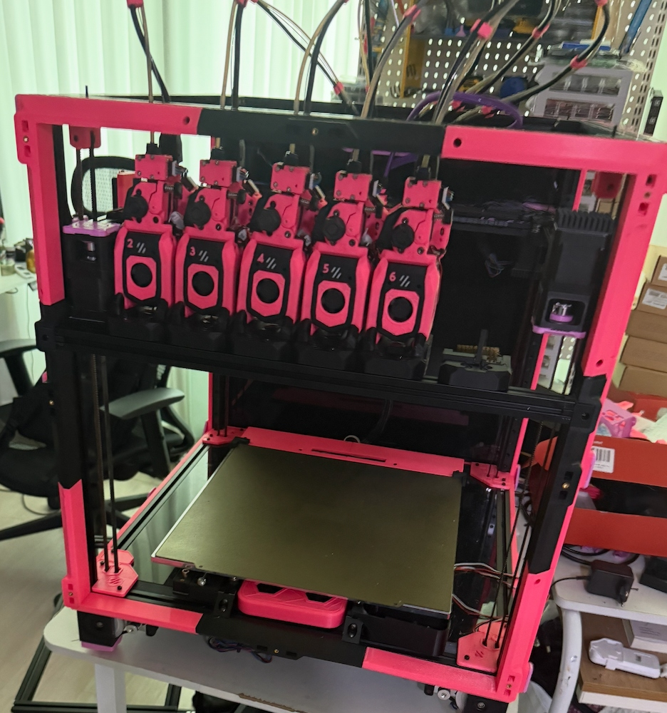
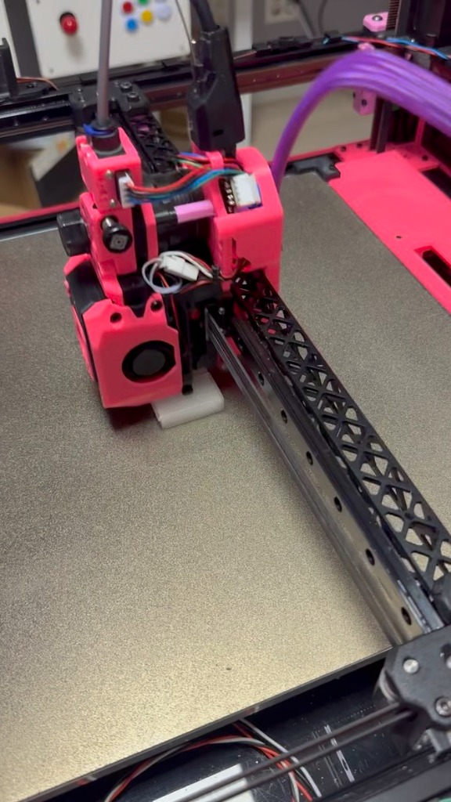

# Voron 2.4 350mm AWD StealthChanger — Klipper Config & Hardware

> **Developer:** Yeonjo Ahn

This directory contains the Klipper configurations (`config/`), custom Klipper host extension modules (`klipper-extras/`), and hardware engineering documentation, interactive wiring diagrams, and 3D models (`hardware/`) for the **Voron 2.4 350mm Crossed AWD + StealthChanger Multi-Tool 3D Printer**.

---

## 1. Build Gallery

| Multi-Tool Dock Array | Active Toolhead Shuttle |
| :---: | :---: |
|  |  |

---

## 2. Hardware Specifications

| Subsystem | Specification |
|---|---|
| **Motion Frame & Kinematics** | Voron 2.4 350mm, **Crossed AWD (4-Motor XY Drive, 42STH48-2004MAH ×4)** |
| **Primary MCU** | **BTT Kraken V1.1** (`STM32H723`, 8× onboard TMC5160 SPI3 stepper drivers) |
| **Toolchanger System** | **StealthChanger** modular front docks + kinematic shuttle coupling |
| **Toolhead CAN Boards** | **Fly-SHT36 V2/V3 (`RP2040` CANbus)** × 5–6 (`SHT0` ~ `SHT4/5`) |
| **Extruders & Hotends** | Galileo 2 Extruder + Bambu Lab Hotend per toolhead |
| **Probing & Homing** | XY: TMC5160 Sensorless Homing (`SGT: 0`) / Z: Upper Z-Max Endstop + Smart Effector / Tool Probes |
| **Purge & Nozzle Wiping** | **Gantry Servo Arm** (servo-actuated retractable purge bucket & silicone brush) |
| **Filament Feeder** | **PinkBox / BoxTurtle** 6-lane automated filament loader |

---

## 3. Core Firmware & Motion Architecture

### 1. Crossed AWD Mapping & Asymmetric Current Sensorless Homing
* **A-Belt (X Axis)**: `stepper_x` (Front Left, S4) + `stepper_x1` (Rear Right, S1)
* **B-Belt (Y Axis)**: `stepper_y` (Rear Left, S2) + `stepper_y1` (Front Right, S3)
* **Asymmetric Sensorless Homing (`toolchanger-config.cfg`)**:
  * Dynamically lowers primary and secondary motor currents asymmetrically during homing (`Y`: Primary `0.80A` / Secondary `0.30A`, `X`: Primary `0.75A` / Secondary `0.20A`) so the secondary motor never counteracts StallGuard stall detection on the primary motor.

### 2. StealthChanger Dock Trajectories & Safety Interlocks
* **`toolchanger-include.cfg`**: Orchestrates loading of the core toolchanger configs while overriding default homing with the custom AWD safety homing routine.
* **`toolchanger-config.cfg`**:
  * Uses `[rounded_path]` to interpolate smooth 3D curved dock entry/exit paths.
  * `CALIBRATE_ALL_OFFSETS`: Sequentially probes all toolheads over the sexbolt XY/Z calibration sensor.
  * `CALIBRATE_ALL_TOOL_PID`: Runs PID calibration across all docked toolhead heaters without requiring shuttle pickup.

### 3. Automated Purge & Nozzle Cleaning (`macros.cfg`)
* Enforces safe Y traversal (`safe_y: 120`) prior to lateral moves to prevent dock collisions, deploys the Gantry Servo arm for purging, and executes multi-pass brush wiping (`_CLEAN_NOZZLE`).

---

## 4. Directory Layout

* **`config/`**: Complete Klipper, Moonraker, KlipperScreen, and Crowsnest configurations (`printer.cfg`, `macros.cfg`, `toolchanger-config.cfg`, `T0.cfg`~`T4.cfg`, `boxturtle.cfg`, etc.)
* **`klipper-extras/`**: Python host extensions (`toolchanger.py`, `tool.py`, `tool_probe_endstop.py` with duplicate-command guard patches, `rounded_path.py`, `tools_calibrate.py`, `smart_effector.py`)
* **`hardware/`**:
  * [`GPIO_PINOUT.md`](./hardware/GPIO_PINOUT.md): Complete pin assignment reference for BTT Kraken V1.1 and Fly-SHT36 toolboards
  * [`HOTEND_CAN_BOARD_SPEC.md`](./hardware/HOTEND_CAN_BOARD_SPEC.md): Custom RP2040 Zero + SN65HVD230 hotend CAN expansion board circuit & BOM specification
  * `wiring/`: Interactive HTML wiring diagrams for BTT Kraken V1.1, BoxTurtle, and SSR AC Heated Bed
  * `stl/`: 3D printable STL models for the Gantry Servo arm and mounts
